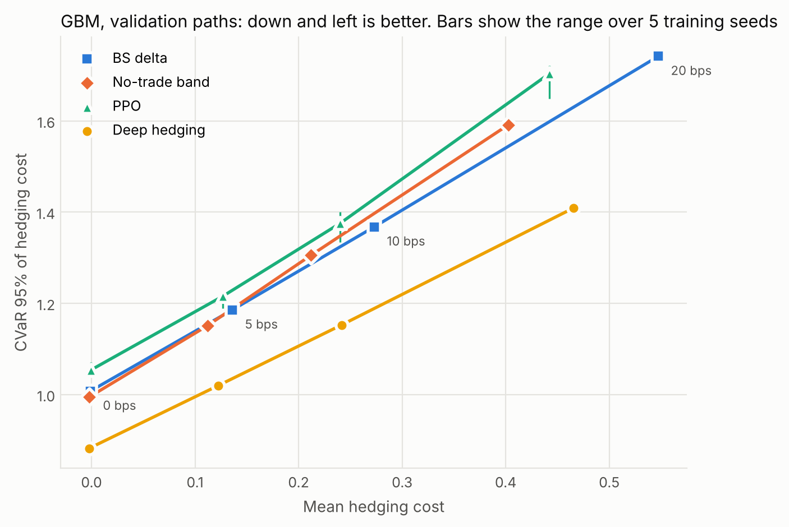
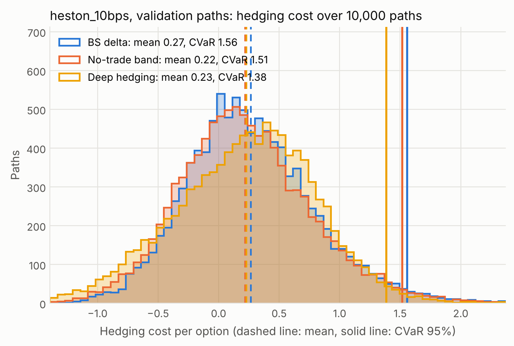
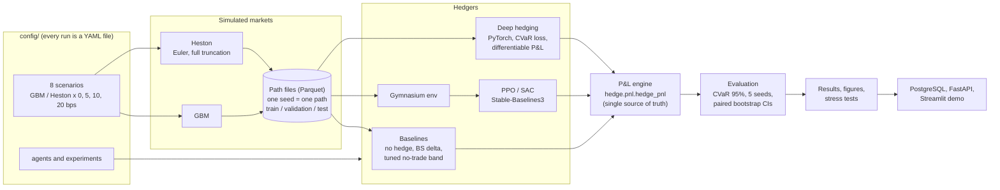
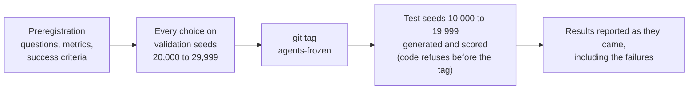

<div align="center">

# Learning to hedge: deep hedging vs reinforcement learning vs Black-Scholes

**Can a learned hedger beat the textbook delta hedge on a short option once trading costs
money and the market model is wrong? I tested it on 10,000 held-out paths per scenario,
set aside before any training and scored only after the setup was frozen in git.**

[](https://github.com/AradhyaSomani/rl-derivative-hedging/actions/workflows/ci.yml)


</div>

> [!IMPORTANT]
> **Headline (test paths, scored after the freeze):** a deep hedging network trained
> directly on tail risk cuts **CVaR 95% by 10% to 18% against Black-Scholes delta in all 8
> scenarios**, with a paired bootstrap 95% interval that excludes zero every time, and
> beats a tuned no-trade band in all 8 too. Model-free RL (PPO, SAC) makes the hedge
> **7% to 12% cheaper on average** at 10 bps but **not safer**: it does not beat delta on
> tail risk in any scenario, and the simple band beats it everywhere.

<p align="center">
  
  <br>
  <em>Cost against tail risk on the GBM test paths at 0, 5, 10 and 20 bps. Down and to the
  left is better. Deep hedging (orange) sits on its own frontier below every other strategy.</em>
</p>

## Contents

- [Why this problem](#why-this-problem)
- [Results](#results)
- [How it works](#how-it-works)
- [How the test set was kept clean](#how-the-test-set-was-kept-clean)
- [Stress tests](#stress-tests)
- [Limitations](#limitations)
- [Quickstart](#quickstart)
- [Live demo, API and database](#live-demo-api-and-database)
- [Repository map](#repository-map)
- [Further reading](#further-reading)

## Why this problem

A desk that sells an option hedges it by trading the underlying. The textbook rule,
Black-Scholes delta hedging, is optimal only in a frictionless world with a known model.
Real hedging has neither: every rebalance costs money, and volatility is not constant. That
leaves two practical questions every derivatives desk faces:

1. How much should you **trade less** to save costs, and at what price in tail risk?
2. How much does it cost you to hedge with the **wrong model**?

Learned hedgers (Buehler et al., 2019, *Deep hedging*; and a growing RL literature) promise
to answer both from data. This project puts those promises on trial against strong, honest
baselines, with the experimental discipline of a clinical trial: questions and metrics
written down first, every choice made on validation data, and a test set that could not be
generated until the setup was tagged in git.

## Results

CVaR 95% of hedging cost (the average of the worst 5% of 10,000 test paths; lower is
better) at 10 basis points. Learned strategies are the median of 5 training seeds.

| Strategy | GBM (model right) | Heston (model wrong) | Mean cost, GBM | Mean cost, Heston |
| --- | --- | --- | --- | --- |
| Black-Scholes delta | 1.369 | 1.552 | 0.278 | 0.280 |
| No-trade band (tuned) | 1.322 | 1.503 | 0.222 | 0.238 |
| PPO (tuned, 1M steps) | 1.396 | 1.629 | 0.249 | 0.246 |
| SAC (100k steps) | 1.408 | 1.602 | 0.257 | 0.249 |
| **Deep hedging** | **1.170** | **1.376** | 0.249 | 0.244 |

Deep hedging's CVaR gap to delta in every scenario, with paired bootstrap 95% intervals
(2,000 resamples of the test paths):

| Market | 0 bps | 5 bps | 10 bps | 20 bps |
| --- | --- | --- | --- | --- |
| GBM | -0.114 (-0.133 to -0.095) | -0.154 (-0.175 to -0.133) | -0.199 (-0.222 to -0.176) | -0.309 (-0.337 to -0.280) |
| Heston | -0.127 (-0.145 to -0.108) | -0.143 (-0.165 to -0.121) | -0.176 (-0.201 to -0.152) | -0.261 (-0.291 to -0.230) |

<p align="center">
  
  <br>
  <em>Heston, 10 bps: deep hedging gives up some symmetry (a wider left side) to cut the bad
  right tail. Solid lines mark each strategy's CVaR 95%.</em>
</p>

**The three preregistered questions, answered on the test set:**

| Question | Answer |
| --- | --- |
| Does an RL agent get lower tail loss than delta and the no-trade band, at the same or lower cost? | **No.** PPO beats delta on CVaR in 0 of 8 scenarios, SAC in 0 of 2. Deep hedging (not RL) does, in 8 of 8. |
| On Heston, how much of the gain comes from learning around the wrong model? | **None detectable.** Deep hedging's edge over delta is 10% to 14% on Heston and 11% to 18% on GBM, where delta has the right model. The gain comes from handling costs and the tail. |
| Does model-free RL match deep hedging (within 5% CVaR)? | **No.** PPO is 18% to 22% worse at 10 and 20 bps. |

**What the numbers say, in one line:** the method that optimises the tail of the whole
episode directly wins; step-by-step RL with a per-step reward learns to trade less, which
is cheaper but not safer than the textbook rule.

Full tables (mean, standard deviation, CVaR, seed range, interval, turnover for every
strategy and scenario), the validation-vs-test comparison, and everything that did not work
are in [docs/results.md](docs/results.md).

## How it works



**The setup.** The hedger is short one at-the-money European call (strike 100, 30 trading
days) and rebalances its stock holding once a day, paying proportional costs on every
trade. Hedging cost is minus the P&L, so positive is a loss.

- **Markets.** GBM with 20% volatility, where Black-Scholes is the true model, and Heston
  with stochastic, leverage-correlated volatility (v0 = theta = 0.04, kappa = 2, xi = 0.3,
  rho = -0.7), where it is wrong. Four cost levels each: eight scenarios.
- **Baselines.** No hedge; Black-Scholes delta every day; and a **no-trade band** around
  delta whose width is tuned per scenario on validation paths. The band is the real bar:
  it is simple, cost-aware, and what practitioners use.
- **Reinforcement learning.** A Gymnasium environment where the agent sees time to expiry,
  moneyness, its holding, the BS delta and (on Heston) the current variance, and outputs a
  correction of at most 0.25 shares around delta. PPO was chosen after a 12-run reward grid
  (quadratic, mean-variance, terminal CVaR at four penalty weights) and a 30-trial Optuna
  search; SAC ran with default settings.
- **Deep hedging.** The same network, inputs and action, trained by back-propagating the
  CVaR 95% of 5,000 simulated episodes per step through a PyTorch copy of the P&L engine
  (tested against the NumPy one), with early stopping on validation CVaR. One run takes
  about 100 seconds on a CPU.

**Engineering rules the code enforces** (each one has tests behind it):

- **One P&L engine** scores every strategy. It is tested against an independent
  cash-account implementation, the exact no-hedge result, and the vanishing variance of a
  frequent, cost-free delta hedge.
- **The environment adds no accounting of its own.** Its per-step P&Ls sum to the engine's
  total for every reward type, and a scripted agent that returns delta reproduces the delta
  baseline on all 10,000 validation paths to within 7e-15.
- **Same paths for every strategy.** One seed makes one path on any machine; scenarios that
  differ only in cost share one path file.
- **Every run is traceable.** Each run folder records the config hashes, the path-file hash,
  the seed and the git commit.

## How the test set was kept clean

Most backtests leak. This one was built so that it could not.



- **Plan first.** The questions, metrics and what would count as support are in
  [docs/preregistration.md](docs/preregistration.md), including an honest log of which
  items were written after validation results were known.
- **Separate seed ranges** for training (100,000 to 199,999), validation and test, with a
  unit test that fails if they overlap.
- **The test set is locked in code.** The simulators and path loader refuse test seeds
  unless called with `allow_test=True`, and the final evaluation refuses to run at all
  unless the git tag `agents-frozen` exists.
- **Risk, seeds and intervals.** Every learned strategy is the median of 5 training seeds
  with its range, and every comparison with delta is a paired bootstrap interval.
- **It paid off.** On validation PPO beat delta at GBM 20 bps with an interval that
  excluded zero. On test it was 0.006 *worse*, interval spanning zero. Without the held-out
  set, that false win would be in this README.

The test run was made twice on 2026-11-14 (the second by mistake, with only documentation
changed in between); every number in the result tables was identical. Both runs are
recorded in section 9 of the preregistration.

## Stress tests

Agents frozen at GBM 10 bps, scored on test seeds under conditions they never saw.

| Stress | BS delta | No-trade band | PPO | SAC | Deep hedging |
| --- | --- | --- | --- | --- | --- |
| None (GBM 10 bps) | 1.369 | 1.322 | 1.396 | 1.408 | **1.170** |
| Volatility 30% instead of 20% | 4.217 | 4.029 | 4.198 | 4.270 | **3.606** |
| Heston paths, agents trained on GBM | 1.629 | 1.534 | 1.632 | 1.659 | **1.423** |
| Jumps added to GBM | 6.045 | 5.939 | 6.066 | 6.096 | **5.884** |

Deep hedging keeps the lowest CVaR under every stress, but **jumps shrink its edge** over
delta from 15% to 3%: nobody can hedge a jump by trading the stock once a day, learned or
not, and the network gives little protection against a risk absent from its training
paths. With jumps on Heston paths, PPO and SAC beat delta and the band for the only time in
the project, and deep hedging is still lower.

An **exploratory** follow-up (decided after the test results, run on validation seeds, and
labelled as post hoc) replays the Heston stresses with the much wilder parameters of
Buehler et al. (2019): every hedger's CVaR roughly triples and the gaps between them shrink
to a few percent (PPO trained on Heston draws level with deep hedging there). With jumps
added on top, deep hedging is the only strategy that clearly helps (CVaR 7.54 against 8.87
for delta). Details in
[docs/results.md](docs/results.md#exploratory-heston-with-the-deep-hedging-papers-parameters-validation-post-hoc).

## Limitations

- **Simulated markets only.** One option, one maturity, daily trading, two models. A real
  market has no known model to differentiate through, which is exactly where deep hedging's
  requirement is hardest to meet.
- **Zero interest rate and zero drift.** A positive rate would add financing and
  discounting; it was not tested.
- **Not an equal-data fight.** Deep hedging saw about 150 million simulated trading days
  per run against PPO's 1 million, and optimises CVaR directly while RL optimises a
  per-step stand-in. The fair reading is "if you can differentiate through your simulator,
  do that", not "RL cannot hedge".
- **SAC had a small budget:** 100,000 steps, default hyperparameters, two scenarios. Its
  result holds under that budget only.
- **RL tuning was modest:** one 30-trial search, on GBM only.
- **Lower tail, higher spread.** Deep hedging has a lower CVaR but a higher standard
  deviation than delta (0.49 vs 0.45 at GBM 10 bps). It is better on the tail, not in every
  sense.
- **The agents start from delta** and move at most 0.25 shares away from it, so this
  measures improvement on delta, not learning to hedge from scratch.

## Quickstart

Requires Python 3.10 or later. No GPU is needed.

```bash
git clone https://github.com/AradhyaSomani/rl-derivative-hedging.git
cd rl-derivative-hedging
python3 -m venv .venv && source .venv/bin/activate
make install   # pip install -e ".[dev,rl,serve]" (includes PyTorch) and pre-commit hooks
make test      # 121 tests
make app       # the demo on http://localhost:8501, using the committed results sample
```

The demo needs no training run or database: it reads the small committed copy of the test
results and frozen weights in `app/sample` (about 7 MB).

See the cash account of one delta-hedged path, day by day:

```bash
python -m hedge.cli walkthrough --scenario config/scenarios/gbm_10bps.yaml --seed 0
```

**Reproduce the whole study** (times on a 4-core CPU laptop):

| Step | Command | Time |
| --- | --- | --- |
| Train and validation paths | `make paths` | about 1 minute |
| Baselines, band tuned on validation | `make baselines` | under 1 minute |
| Train 90 runs (40 PPO, 10 SAC, 40 deep hedging) | `make train JOBS=4` | about 2 hours (8 CPU-hours) |
| Score everything on validation, with bootstrap intervals | `make eval` | under 1 minute |
| Stress tests | `make stress` | about 1 minute |
| Figures and the demo's sample | `make report` | under 1 minute |
| All of the above | `make all` | about 2 hours |

The validation table was reproduced digit for digit on a second machine (Linux with Python
3.13 and macOS with Python 3.14) from the same trained weights. The single test run is
`make final-test`; it needs the `agents-frozen` tag and has already been made, so rerunning
it adds nothing. The experiments that led to the frozen setup can be rerun from
`config/experiments/` with `python -m hedge.cli experiment --config <file>` and
`python -m hedge.cli tune --config <file>`.

## Live demo, API and database

<!-- TODO(Aradhya): replace both placeholders once the demo is hosted and the video is recorded. -->

- **Hosted demo:** _coming soon (link to be added)_
- **Demo video:** _coming soon (link to be added)_

The Streamlit app has five pages: a race between two hedgers on one path, cost
distributions over 10,000 paths, the cost against tail-risk frontier with the stress tests,
a "try it" page where you change cost and volatility and the frozen agents hedge fresh
paths live, and a plain-English summary. To host it (for example on Streamlit Community
Cloud), point it at `app/streamlit_app.py` with `app/requirements.txt`.

```bash
createdb hedging
export DATABASE_URL=postgresql://localhost:5432/hedging
make db    # loads every result into PostgreSQL (about 1.1 million per-path rows)
make api   # FastAPI on http://localhost:8000, interactive docs at /docs
```

The API serves the stored results (`/scenarios`, `/strategies`, `/results`, `/frontier`,
`/evaluations`, `/stress`, per-path detail and learning curves) and runs the frozen agents
live: `POST /hedge` returns each agent's holding for one market state, and
`POST /simulate` hedges up to 1,000 fresh paths with every strategy. The files in `data/`
stay the source of truth; `make db` rebuilds the database from them.

## Repository map

```text
config/            scenarios/, agents/, experiments/, eval.yaml (the frozen line-up)
src/hedge/
  seeds.py         seed ranges for train, validation and test; one seed per path
  pnl.py           the one P&L engine every strategy is scored by
  market/          black_scholes.py, gbm.py, heston.py, pathsets.py
  baselines/       no hedge, BS delta, no-trade band
  env/             hedging_env.py (Gymnasium), rewards.py
  agents/          train_sb3.py (PPO, SAC), deep_hedging.py, experiment.py, tune.py (Optuna)
  eval/            metrics, evaluate, final.py (the test guard), stress, plots, report
  db/, api/        PostgreSQL schema and loader, FastAPI service
  cli.py           every command: python -m hedge.cli --help
app/               Streamlit demo and its committed results sample
tests/             121 tests (pytest and Hypothesis), run in CI on Python 3.10 and 3.12
docs/              preregistration, results, report, theory, figures
data/              generated paths, runs and results (git-ignored)
```

## Further reading

- [docs/report.md](docs/report.md): the whole project in plain language, top to bottom.
- [docs/results.md](docs/results.md): every table, the Phase 3 search, stress tests and
  what did not work.
- [docs/preregistration.md](docs/preregistration.md): the plan, the frozen choices and the
  log of changes after the tag.
- [docs/theory.md](docs/theory.md): the maths behind the hedges, the rewards and CVaR.

**Reference.** H. Buehler, L. Gonon, J. Teichmann and B. Wood (2019), "Deep hedging",
*Quantitative Finance* 19(8), 1271-1291.
