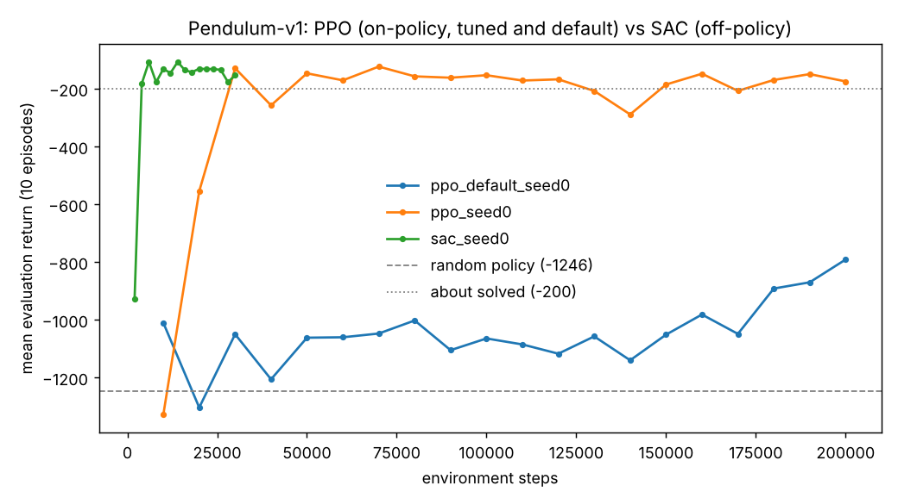

# Pendulum warm-up: PPO and SAC on Pendulum-v1

The task list's warm-up before the hedging environment: train PPO on stable-baselines3's
Pendulum example, learn the training loop, and read the TensorBoard curves. SAC and PPO with
default settings were added as comparisons because they teach the two lessons that matter for
this project.

**What was run.** `notebooks/pendulum_warmup.py`, one seed (0) each, in a cloud Linux
container with stable-baselines3 2.9.2, torch 2.15 (CPU) and gymnasium, on 2026-11-14. It has
not been run on the Mac. Evaluation is 10 episodes with deterministic actions on a separate
environment seed, every 10,000 steps (every 2,000 for SAC).

```bash
source .venv/bin/activate
python notebooks/pendulum_warmup.py --algo ppo --timesteps 200000 --seed 0          # about 5 min
python notebooks/pendulum_warmup.py --algo ppo_default --timesteps 200000 --seed 0  # about 5 min
python notebooks/pendulum_warmup.py --algo sac --timesteps 30000 --seed 0 --eval-every 2000
python notebooks/pendulum_warmup.py --plot
tensorboard --logdir data/pendulum/tb      # then open http://localhost:6006
```

Outputs go to `data/pendulum/` (git-ignored); `--plot` writes `data/pendulum/pendulum_curves.png`. Timings are from the cloud run; SAC took 5
minutes there because it does a gradient step for every environment step.

## The task

Swing a pendulum up and keep it upright with a limited torque. Each episode is 200 steps and
the reward per step is $`-(\theta^2 + 0.1\,\dot\theta^2 + 0.001\,u^2)`$, so 0 is perfect. A
random policy scores about -1,250 (measured: -1,246 over 20 episodes). About -200 or better
means it swings up and balances; a short swing-up costs a little from most starting angles.

## Results



| Run | Steps | First evaluation better than -200 | Final evaluation (20 episodes) |
| --- | --- | --- | --- |
| SAC, defaults except learning rate 1e-3 | 30,000 | 4,000 steps | -138 ± 86 |
| PPO, rl-baselines3-zoo tuned settings | 200,000 | 30,000 steps | -218 ± 139 |
| PPO, stable-baselines3 defaults | 200,000 | never | -827 ± 189 |

One seed each, so treat the exact numbers loosely; the ordering is the well-known one.

**Lesson 1: off-policy is far more sample-efficient.** SAC keeps every transition in a replay
buffer and learns from each one many times; PPO uses each rollout for 10 epochs and throws it
away. SAC got there in about a seventh of the steps. The hedging project saw the reverse on
quality (SAC was worse than PPO on the test set), so sample efficiency is not the same thing
as a better final policy.

**Lesson 2: PPO is sensitive to its settings, and the curves say why.** The tuned set changes
the discount `gamma` from 0.99 to 0.9, raises the learning rate to 1e-3, collects 1,024 steps
per environment per update and uses state-dependent exploration (gSDE). The table below, read
from TensorBoard, shows what went wrong with the defaults: the critic never learned.

## Reading the TensorBoard curves

Values at a few points of each PPO run (x is environment steps).

| Curve | Tuned PPO: 8k → 30k → 57k → 200k | Default PPO: 10k → 60k → 110k → 200k | What it tells you |
| --- | --- | --- | --- |
| `rollout/ep_rew_mean` | -1,239 → -975 → -280 → -172 | -1,157 → -1,124 → -1,123 → -883 | Training return, with exploration noise. Noisier and lower than the evaluation return. |
| `train/explained_variance` | 0.00 → 0.98 → 1.00 → 1.00 | 0.00 → 0.00 → 0.00 → 0.85 | How well the critic predicts returns (1 is perfect, 0 is no better than a constant). The most useful single diagnostic: if it stays near 0, the advantages are noise and the policy cannot improve. |
| `train/value_loss` | 630 → 9.5 → 0.42 → 0.07 | 6,349 → 3,306 → 1,110 → 192 | Critic error. With `gamma = 0.99` returns are about 10 times larger, so the critic has a much harder target. That is the main reason the defaults fail here. |
| `train/std` | 1.05 → 0.42 → 0.25 → 0.14 | 1.01 → 0.99 → 0.97 → 0.84 | Exploration noise of the policy. It should shrink as the policy gets confident; staying near 1 means it is still acting close to randomly. |
| `train/approx_kl` | 0.02 → 0.05 → 0.02 → 0.07 | 0.002 → 0.002 → 0.003 → 0.009 | How far each update moved the policy. Tiny values mean updates are barely changing anything; above about 0.1 updates are probably too big. |
| `train/clip_fraction` | 0.12 → 0.31 → 0.21 → 0.42 | 0.01 → 0.01 → 0.03 → 0.08 | Share of samples where PPO's clip was active. Rising late in the tuned run means it keeps pushing against the limit; a learning-rate decay would calm it. |

**What to look for in the hedging runs.** The same three curves matter most: explained
variance (is the critic learning the step P&L?), the policy's std (is it still exploring?)
and the evaluation metric on validation paths, which for hedging is CVaR 95% rather than the
mean reward. A reward curve that rises while validation CVaR does not improve is the
hedging version of overfitting to the reward.

## Files

- `notebooks/pendulum_warmup.py`: the script (exploration only, nothing imports it).
- `docs/figures/pendulum_curves.png`: the figure above, from the cloud run.
