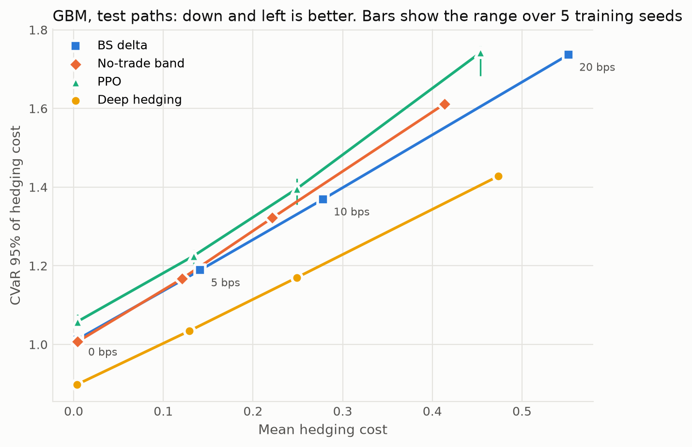
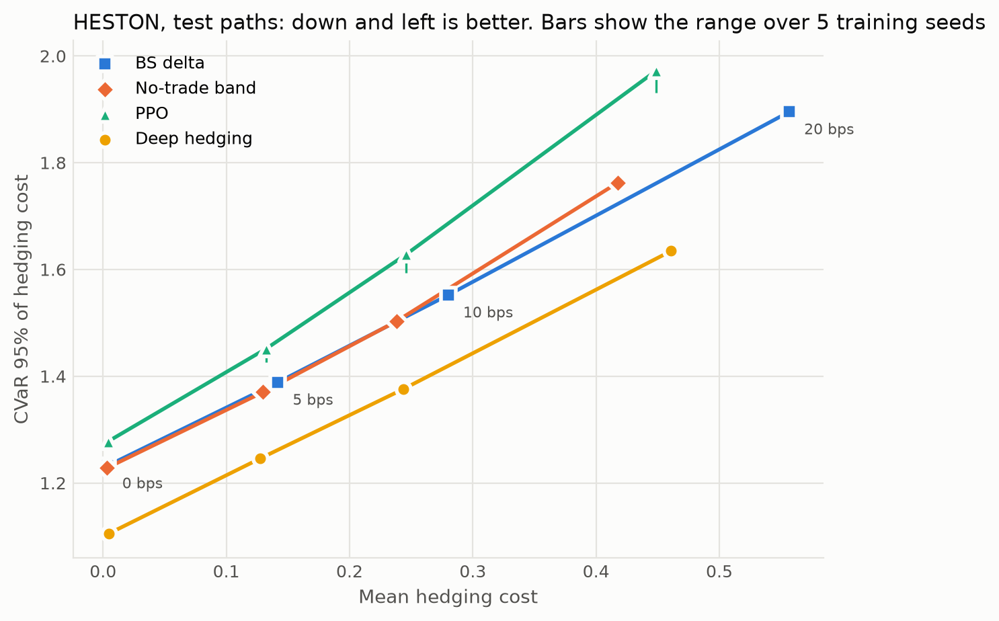
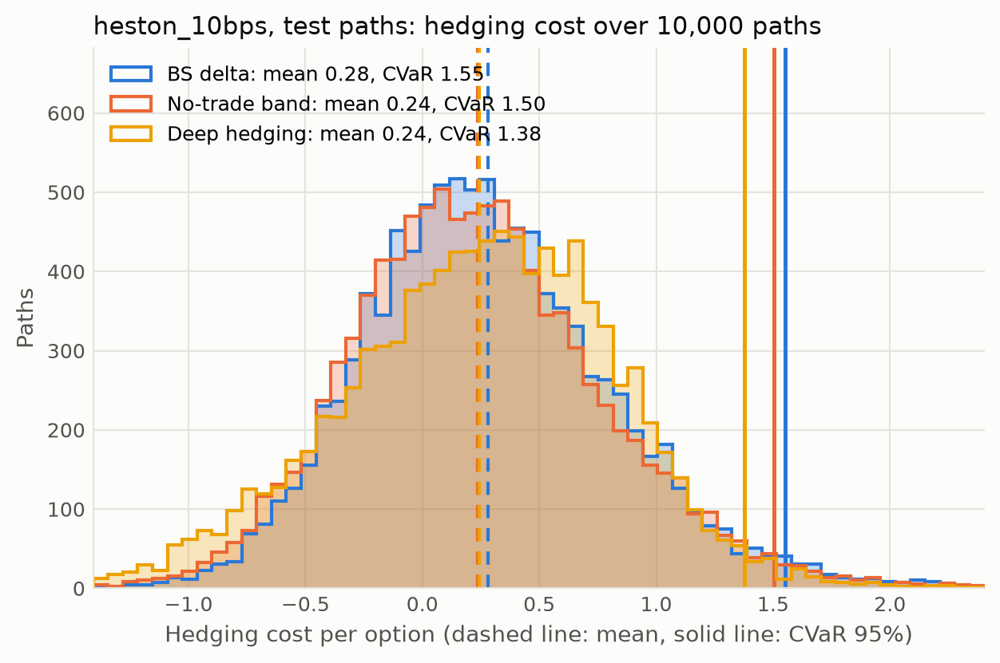
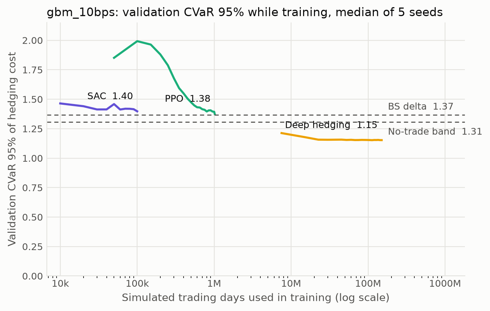

# Results

**Status: final.** The headline table and the stress tests below are on the **test** paths
(seeds 10,000 to 19,999), which were generated and scored once, on 2026-11-14, after the
setup was frozen with the git tag `agents-frozen`. Every choice (rewards, action space,
hyperparameters, band width, which seed is shown) was made on validation paths before that;
those sections are labelled as validation. No strategy or setting was changed after seeing
the test numbers.

## Answers to the three questions (test paths)

1. **Does an RL agent get a lower tail loss than delta hedging and the no-trade band, at the
   same or lower average cost?** No. PPO does not beat delta on CVaR 95% in any of the eight
   scenarios, and SAC does not in the two it ran on. Both are 7% to 12% cheaper than delta on
   average at 10 basis points, but the tuned no-trade band is cheaper still and has a smaller
   tail. The deep hedging network, which is not RL, does what the question asks: its CVaR 95%
   is 10% to 18% lower than delta's in every scenario, at the same or a lower average cost, with a
   bootstrap interval that excludes zero every time. It also has a lower CVaR than the band
   in every scenario.
2. **On Heston paths, how much of the RL agent's gain comes from learning around the wrong
   model?** There is no RL gain to explain: on Heston, PPO's CVaR is 0.05 to 0.08 worse than
   delta's at every cost level, although the agent sees the variance. Deep hedging's edge over
   delta is no larger on Heston (10% to 14%) than on GBM (11% to 18%), where delta has the
   right model. So the gain comes from handling costs and the tail, not from correcting the
   model.
3. **Does model-free RL match deep hedging?** No. PPO's CVaR is 18% to 22% higher than deep
   hedging's at 10 and 20 basis points, far outside the 5% set as a match beforehand.

One line: the method that optimises the tail of the whole episode directly wins, and
step-by-step RL with a per-step reward gives a cheaper but not a safer hedge than the textbook
rule.

## Headline table (test, 10,000 paths per scenario)

Learned strategies show the median over 5 training seeds. The gap column is the CVaR 95% of
the seed with the median CVaR minus BS delta's on the same paths, with a paired bootstrap
interval (2,000 resamples); negative is better than delta.

| Scenario | Strategy | Mean cost | Std | CVaR 95% | CVaR range over seeds | CVaR gap vs delta (95% CI) | Turnover |
|---|---|---|---|---|---|---|---|
| gbm_0bps | BS delta | 0.004 | 0.433 | 1.013 | n/a | n/a | 2.71 |
| gbm_0bps | No-trade band | 0.004 | 0.438 | 1.007 | n/a | -0.006 (-0.013 to +0.001) | 2.48 |
| gbm_0bps | PPO | 0.004 | 0.435 | 1.058 | 1.045 to 1.076 | +0.046 (+0.042 to +0.050) | 2.75 |
| gbm_0bps | **Deep hedging** | 0.004 | 0.477 | 0.898 | 0.897 to 0.900 | -0.114 (-0.133 to -0.095) | 2.56 |
| gbm_5bps | BS delta | 0.141 | 0.439 | 1.189 | n/a | n/a | 2.71 |
| gbm_5bps | No-trade band | 0.121 | 0.458 | 1.167 | n/a | -0.022 (-0.036 to -0.008) | 2.29 |
| gbm_5bps | PPO | 0.134 | 0.447 | 1.225 | 1.201 to 1.241 | +0.036 (+0.024 to +0.049) | 2.56 |
| gbm_5bps | **Deep hedging** | 0.129 | 0.488 | 1.035 | 1.034 to 1.037 | -0.154 (-0.175 to -0.133) | 2.48 |
| gbm_10bps | BS delta | 0.278 | 0.449 | 1.369 | n/a | n/a | 2.71 |
| gbm_10bps | No-trade band | 0.222 | 0.486 | 1.322 | n/a | -0.047 (-0.067 to -0.027) | 2.14 |
| gbm_10bps | PPO | 0.249 | 0.466 | 1.396 | 1.356 to 1.421 | +0.027 (+0.007 to +0.048) | 2.41 |
| gbm_10bps | SAC | 0.257 | 0.473 | 1.408 | 1.368 to 1.427 | +0.039 (+0.019 to +0.061) | 2.49 |
| gbm_10bps | **Deep hedging** | 0.249 | 0.492 | 1.170 | 1.169 to 1.171 | -0.199 (-0.222 to -0.176) | 2.42 |
| gbm_20bps | BS delta | 0.552 | 0.478 | 1.737 | n/a | n/a | 2.71 |
| gbm_20bps | No-trade band | 0.414 | 0.530 | 1.612 | n/a | -0.125 (-0.151 to -0.099) | 2.02 |
| gbm_20bps | PPO | 0.454 | 0.524 | 1.742 | 1.683 to 1.758 | +0.006 (-0.027 to +0.038) | 2.21 |
| gbm_20bps | **Deep hedging** | 0.474 | 0.514 | 1.428 | 1.427 to 1.429 | -0.309 (-0.337 to -0.280) | 2.32 |
| heston_0bps | BS delta | 0.003 | 0.536 | 1.232 | n/a | n/a | 2.74 |
| heston_0bps | No-trade band | 0.003 | 0.536 | 1.228 | n/a | -0.004 (-0.007 to -0.000) | 2.61 |
| heston_0bps | PPO | 0.004 | 0.527 | 1.278 | 1.264 to 1.284 | +0.046 (+0.024 to +0.067) | 2.70 |
| heston_0bps | **Deep hedging** | 0.005 | 0.555 | 1.105 | 1.103 to 1.111 | -0.127 (-0.145 to -0.108) | 2.51 |
| heston_5bps | BS delta | 0.142 | 0.535 | 1.388 | n/a | n/a | 2.74 |
| heston_5bps | No-trade band | 0.130 | 0.537 | 1.370 | n/a | -0.018 (-0.026 to -0.011) | 2.50 |
| heston_5bps | PPO | 0.132 | 0.550 | 1.451 | 1.426 to 1.463 | +0.063 (+0.038 to +0.088) | 2.52 |
| heston_5bps | **Deep hedging** | 0.127 | 0.565 | 1.246 | 1.240 to 1.249 | -0.143 (-0.165 to -0.121) | 2.43 |
| heston_10bps | BS delta | 0.280 | 0.537 | 1.552 | n/a | n/a | 2.74 |
| heston_10bps | No-trade band | 0.238 | 0.546 | 1.503 | n/a | -0.049 (-0.064 to -0.034) | 2.32 |
| heston_10bps | PPO | 0.246 | 0.576 | 1.629 | 1.594 to 1.638 | +0.077 (+0.046 to +0.107) | 2.38 |
| heston_10bps | SAC | 0.249 | 0.582 | 1.602 | 1.584 to 1.642 | +0.050 (+0.024 to +0.078) | 2.42 |
| heston_10bps | **Deep hedging** | 0.244 | 0.575 | 1.376 | 1.374 to 1.382 | -0.176 (-0.201 to -0.152) | 2.36 |
| heston_20bps | BS delta | 0.557 | 0.549 | 1.895 | n/a | n/a | 2.74 |
| heston_20bps | No-trade band | 0.418 | 0.584 | 1.763 | n/a | -0.132 (-0.159 to -0.105) | 2.05 |
| heston_20bps | PPO | 0.449 | 0.636 | 1.973 | 1.931 to 1.985 | +0.077 (+0.037 to +0.118) | 2.19 |
| heston_20bps | **Deep hedging** | 0.461 | 0.594 | 1.635 | 1.632 to 1.637 | -0.261 (-0.291 to -0.230) | 2.26 |

Things to notice:

- Deep hedging's seeds agree closely (CVaR range under 0.01 in every scenario). PPO's spread
  across seeds is 0.02 to 0.08, as large as its gap to delta.
- Deep hedging lowers the tail but **raises the standard deviation** (0.49 against 0.45 at
  GBM 10 bps). It gives up some symmetry of the distribution to cut the bad tail, which is
  what it was asked to do. Judged on standard deviation, delta and the band would look better.
- Deep hedging beats delta even at zero cost (CVaR 0.90 against 1.01 on GBM). That is not a
  bug: with daily rebalancing delta hedging is not optimal for a tail measure, and the gain
  comes with a higher standard deviation (0.48 against 0.43).
- The band's edge over delta grows with the cost level, as it should: nothing measurable at
  0 bps (the interval reaches zero), 0.125 at 20 bps on GBM.

## Validation against test

The CVaR gap to delta, as chosen on validation and as measured once on test:

| Scenario | Deep hedging gap, validation | Deep hedging gap, test | PPO gap, validation | PPO gap, test |
|---|---|---|---|---|
| gbm_0bps | -0.125 | -0.114 | +0.046 | +0.046 |
| gbm_5bps | -0.166 | -0.154 | +0.030 | +0.036 |
| gbm_10bps | -0.215 | -0.199 | +0.008 | +0.027 |
| gbm_20bps | -0.333 | -0.309 | -0.038 | +0.006 |
| heston_0bps | -0.135 | -0.127 | +0.036 | +0.046 |
| heston_5bps | -0.148 | -0.143 | +0.060 | +0.063 |
| heston_10bps | -0.173 | -0.176 | +0.077 | +0.077 |
| heston_20bps | -0.251 | -0.261 | +0.075 | +0.077 |

- Deep hedging's edge shrank a little on test in six scenarios and grew in the two expensive
  Heston ones. The conclusion is the same.
- **PPO's only win on validation did not survive.** At GBM 20 bps it was 0.038 better than
  delta on validation with an interval that excluded zero; on test it is 0.006 worse and the
  interval spans zero. At GBM 10 bps, where validation could not separate PPO from delta, the
  test says PPO is worse (interval +0.007 to +0.048). This is what the held-out paths are for.

The full validation table is at the end of this file.

## Phase 3: how the RL agent was chosen (all on GBM 10 bps, validation)

**Reward grid** (default PPO, 1,000,000 steps, action is the holding itself, one seed):

| Reward | lambda 0.1 | 0.5 | 1 | 2 |
|---|---|---|---|---|
| quadratic | 1.545 | 1.603 | 1.561 | 1.476 |
| mean_variance | 4.946 | 3.100 | 2.134 | 1.782 |
| terminal_cvar | 4.561 | 3.071 | 2.818 | 2.908 |

CVaR 95%; delta is 1.368 and the band 1.305. Only the quadratic reward got near delta.

**Delta-offset action.** Letting the agent output a correction of at most 0.25 shares around
the BS delta, instead of the holding itself, improved every lambda (CVaR 1.399 to 1.448) and
made a new run start exactly at the delta hedge.

**Hyperparameter search.** 30 Optuna trials over learning rate, entropy coefficient, discount
and learning-rate schedule. Best: learning rate 4.7e-5, entropy coefficient 2.9e-8, discount
0.925, constant schedule, CVaR 1.376. With those settings lambda 1 was best (1.376; 1.386 at
0.5, 1.407 at 0.1, 1.415 at 2), so the frozen agent is `ppo_tuned_quadratic_l1`.

**SAC against PPO.** SAC with default settings and 100,000 steps reaches CVaR 1.398 on GBM
and 1.580 on Heston at 10 bps, about the same as PPO at 1,000,000 steps (1.376 and 1.634).
PPO at 100,000 steps is still at 1.99. So SAC needs roughly ten times fewer simulated days
for the same result, but one run takes about as long on a CPU (670 s against 450 s), because
SAC does a gradient update on every step.

**Generalisation across cost levels.** The PPO agent trained at 10 bps, run unchanged at
20 bps, has a median CVaR of 1.697, better than delta (1.742) and about the same as the agent
trained at 20 bps (1.704). Run at 5 bps it scores 1.218, worse than delta (1.186). An agent
trained at one cost level trades too little when costs are lower.

## Phase 4: deep hedging and stress tests

**Deep hedging** (`hedge.agents.deep_hedging`): one small network (two layers of 64) used at
every time step, same observations and same delta-offset action as the RL agents, trained by
back-propagating the CVaR 95% of the hedging cost of 5,000 simulated episodes per step
through a PyTorch copy of the P&L engine (a test checks that copy against the NumPy engine).
It stops early on validation CVaR. One run takes about 100 seconds on a CPU.

This is not an equal-data comparison. Deep hedging saw about 150 million simulated trading
days per run against PPO's 1 million, because it can simulate and differentiate whole batches
at once. It also optimises CVaR directly, while the RL agents optimise a per-step reward that
only stands in for it; the RL reward that targeted CVaR at expiry (`terminal_cvar`) trained
worst of all.

**Stress tests** (test seeds; agents frozen at GBM 10 bps unless stated; median over seeds).
Jumps: on average 2 per year, mean log-jump -5%, standard deviation 8%.

| Stress test | Strategy | CVaR 95% before | CVaR 95% under stress | Worsening |
|---|---|---|---|---|
| Volatility 30% (trained at 20%) | BS delta | 1.369 | 4.217 | +2.848 |
| Volatility 30% (trained at 20%) | No-trade band | 1.322 | 4.029 | +2.707 |
| Volatility 30% (trained at 20%) | PPO | 1.396 | 4.198 | +2.802 |
| Volatility 30% (trained at 20%) | SAC | 1.408 | 4.270 | +2.861 |
| Volatility 30% (trained at 20%) | Deep hedging | 1.170 | 3.606 | +2.436 |
| Volatility 10% (trained at 20%) | BS delta | 1.369 | -0.407 | -1.776 |
| Volatility 10% (trained at 20%) | No-trade band | 1.322 | -0.298 | -1.619 |
| Volatility 10% (trained at 20%) | PPO | 1.396 | -0.403 | -1.799 |
| Volatility 10% (trained at 20%) | SAC | 1.408 | -0.382 | -1.791 |
| Volatility 10% (trained at 20%) | Deep hedging | 1.170 | -0.191 | -1.361 |
| Heston paths, agents trained on GBM | BS delta | 1.369 | 1.629 | +0.260 |
| Heston paths, agents trained on GBM | No-trade band | 1.322 | 1.534 | +0.212 |
| Heston paths, agents trained on GBM | PPO | 1.396 | 1.632 | +0.236 |
| Heston paths, agents trained on GBM | SAC | 1.408 | 1.659 | +0.251 |
| Heston paths, agents trained on GBM | Deep hedging | 1.170 | 1.423 | +0.253 |
| Jumps added to GBM | BS delta | 1.369 | 6.045 | +4.676 |
| Jumps added to GBM | No-trade band | 1.322 | 5.939 | +4.617 |
| Jumps added to GBM | PPO | 1.396 | 6.066 | +4.670 |
| Jumps added to GBM | SAC | 1.408 | 6.096 | +4.688 |
| Jumps added to GBM | Deep hedging | 1.170 | 5.884 | +4.714 |
| Jumps added to Heston | BS delta | 1.552 | 6.011 | +4.459 |
| Jumps added to Heston | No-trade band | 1.503 | 5.942 | +4.440 |
| Jumps added to Heston | PPO | 1.629 | 5.692 | +4.064 |
| Jumps added to Heston | SAC | 1.602 | 5.623 | +4.021 |
| Jumps added to Heston | Deep hedging | 1.376 | 5.488 | +4.112 |

- Deep hedging keeps the lowest CVaR under every stress. Its edge over delta is 15% in its
  training market, 15% at 30% volatility, 13% on Heston paths and 3% with jumps on GBM.
- Jumps hurt every hedger by almost the same amount (about +4.7 on GBM). Nobody can hedge a
  jump by trading daily in the stock, learned or not.
- With jumps on Heston the RL agents do beat delta and the band (PPO 5.69 and SAC 5.62
  against 6.01 and 5.94; PPO's interval is -0.39 to -0.25). It is the one place where they
  are ahead of both baselines, and deep hedging is still lower (5.49).
- On Heston paths the GBM-trained deep hedger (1.423) is close to the one trained on Heston
  (1.376), so most of what it learned carries over.
- At 10% volatility every CVaR is negative: the option was sold at a 20% volatility price,
  so even the bad tail is a profit.

## Validation table (used for every choice before the freeze)

Same layout as the headline table, on the 10,000 validation paths per scenario.

| Scenario | Strategy | Mean cost | Std | CVaR 95% | CVaR range over seeds | CVaR gap vs delta (95% CI) | Turnover |
|---|---|---|---|---|---|---|---|
| gbm_0bps | BS delta | -0.001 | 0.433 | 1.008 | n/a | n/a | 2.72 |
| gbm_0bps | No-trade band | -0.002 | 0.438 | 0.994 | n/a | -0.013 (-0.020 to -0.007) | 2.48 |
| gbm_0bps | PPO | -0.001 | 0.437 | 1.053 | 1.039 to 1.071 | +0.046 (+0.042 to +0.050) | 2.76 |
| gbm_0bps | **Deep hedging** | -0.002 | 0.477 | 0.882 | 0.881 to 0.883 | -0.125 (-0.146 to -0.104) | 2.56 |
| gbm_5bps | BS delta | 0.136 | 0.441 | 1.186 | n/a | n/a | 2.72 |
| gbm_5bps | No-trade band | 0.112 | 0.457 | 1.151 | n/a | -0.035 (-0.048 to -0.022) | 2.29 |
| gbm_5bps | PPO | 0.127 | 0.448 | 1.216 | 1.189 to 1.230 | +0.030 (+0.018 to +0.041) | 2.56 |
| gbm_5bps | **Deep hedging** | 0.122 | 0.488 | 1.020 | 1.018 to 1.020 | -0.166 (-0.189 to -0.142) | 2.48 |
| gbm_10bps | BS delta | 0.273 | 0.451 | 1.368 | n/a | n/a | 2.72 |
| gbm_10bps | No-trade band | 0.212 | 0.485 | 1.305 | n/a | -0.063 (-0.082 to -0.043) | 2.14 |
| gbm_10bps | PPO | 0.240 | 0.467 | 1.376 | 1.334 to 1.401 | +0.008 (-0.012 to +0.027) | 2.42 |
| gbm_10bps | SAC | 0.248 | 0.475 | 1.398 | 1.354 to 1.427 | +0.030 (+0.009 to +0.052) | 2.49 |
| gbm_10bps | **Deep hedging** | 0.242 | 0.493 | 1.153 | 1.152 to 1.153 | -0.215 (-0.242 to -0.189) | 2.42 |
| gbm_20bps | BS delta | 0.547 | 0.482 | 1.742 | n/a | n/a | 2.72 |
| gbm_20bps | No-trade band | 0.403 | 0.529 | 1.592 | n/a | -0.150 (-0.176 to -0.125) | 2.02 |
| gbm_20bps | PPO | 0.442 | 0.523 | 1.704 | 1.649 to 1.721 | -0.038 (-0.070 to -0.005) | 2.21 |
| gbm_20bps | **Deep hedging** | 0.466 | 0.515 | 1.409 | 1.408 to 1.411 | -0.333 (-0.365 to -0.302) | 2.32 |
| heston_0bps | BS delta | -0.010 | 0.539 | 1.243 | n/a | n/a | 2.73 |
| heston_0bps | No-trade band | -0.011 | 0.540 | 1.239 | n/a | -0.004 (-0.007 to +0.000) | 2.61 |
| heston_0bps | PPO | -0.008 | 0.529 | 1.279 | 1.264 to 1.284 | +0.036 (+0.014 to +0.059) | 2.70 |
| heston_0bps | **Deep hedging** | -0.009 | 0.557 | 1.108 | 1.107 to 1.108 | -0.135 (-0.154 to -0.117) | 2.50 |
| heston_5bps | BS delta | 0.128 | 0.537 | 1.397 | n/a | n/a | 2.73 |
| heston_5bps | No-trade band | 0.115 | 0.541 | 1.380 | n/a | -0.017 (-0.025 to -0.010) | 2.50 |
| heston_5bps | PPO | 0.119 | 0.553 | 1.457 | 1.429 to 1.461 | +0.060 (+0.036 to +0.085) | 2.51 |
| heston_5bps | **Deep hedging** | 0.113 | 0.568 | 1.249 | 1.248 to 1.251 | -0.148 (-0.169 to -0.128) | 2.43 |
| heston_10bps | BS delta | 0.266 | 0.539 | 1.557 | n/a | n/a | 2.73 |
| heston_10bps | No-trade band | 0.221 | 0.552 | 1.514 | n/a | -0.043 (-0.058 to -0.028) | 2.31 |
| heston_10bps | PPO | 0.232 | 0.580 | 1.634 | 1.596 to 1.637 | +0.077 (+0.048 to +0.106) | 2.38 |
| heston_10bps | SAC | 0.238 | 0.583 | 1.580 | 1.573 to 1.661 | +0.024 (-0.003 to +0.049) | 2.41 |
| heston_10bps | **Deep hedging** | 0.228 | 0.579 | 1.384 | 1.383 to 1.385 | -0.173 (-0.197 to -0.151) | 2.36 |
| heston_20bps | BS delta | 0.542 | 0.551 | 1.893 | n/a | n/a | 2.73 |
| heston_20bps | No-trade band | 0.397 | 0.591 | 1.769 | n/a | -0.124 (-0.153 to -0.096) | 2.04 |
| heston_20bps | PPO | 0.433 | 0.640 | 1.968 | 1.929 to 1.982 | +0.075 (+0.034 to +0.113) | 2.18 |
| heston_20bps | **Deep hedging** | 0.444 | 0.599 | 1.642 | 1.642 to 1.643 | -0.251 (-0.281 to -0.222) | 2.25 |

## Baselines on validation paths (10,000 paths per scenario)

Costs are per option on a stock at 100; the premium is 2.752 on GBM and 2.721 on Heston.
Regenerate with `make paths baselines`.

| Scenario | Strategy | Mean cost | Std | CVaR 95% | Txn cost | Turnover |
| --- | --- | --- | --- | --- | --- | --- |
| gbm_0bps | no_hedge | 0.014 | 4.176 | 12.178 | 0.000 | 0.00 |
| gbm_0bps | bs_delta | -0.001 | 0.433 | 1.008 | 0.000 | 2.72 |
| gbm_0bps | no_trade_band (width 0.01, to edge) | -0.002 | 0.438 | 0.994 | 0.000 | 2.48 |
| gbm_5bps | no_hedge | 0.014 | 4.176 | 12.178 | 0.000 | 0.00 |
| gbm_5bps | bs_delta | 0.136 | 0.441 | 1.186 | 0.137 | 2.72 |
| gbm_5bps | no_trade_band (width 0.02, to edge) | 0.112 | 0.457 | 1.151 | 0.116 | 2.29 |
| gbm_10bps | no_hedge | 0.014 | 4.176 | 12.178 | 0.000 | 0.00 |
| gbm_10bps | bs_delta | 0.273 | 0.451 | 1.368 | 0.274 | 2.72 |
| gbm_10bps | no_trade_band (width 0.03, to edge) | 0.212 | 0.485 | 1.305 | 0.217 | 2.14 |
| gbm_20bps | no_hedge | 0.014 | 4.176 | 12.178 | 0.000 | 0.00 |
| gbm_20bps | bs_delta | 0.547 | 0.482 | 1.742 | 0.549 | 2.72 |
| gbm_20bps | no_trade_band (width 0.04, to edge) | 0.403 | 0.529 | 1.592 | 0.408 | 2.02 |
| heston_0bps | no_hedge | -0.026 | 3.696 | 9.984 | 0.000 | 0.00 |
| heston_0bps | bs_delta | -0.010 | 0.539 | 1.243 | 0.000 | 2.73 |
| heston_0bps | no_trade_band (width 0.005, to edge) | -0.011 | 0.540 | 1.239 | 0.000 | 2.61 |
| heston_5bps | no_hedge | -0.026 | 3.696 | 9.984 | 0.000 | 0.00 |
| heston_5bps | bs_delta | 0.128 | 0.537 | 1.397 | 0.138 | 2.73 |
| heston_5bps | no_trade_band (width 0.01, to edge) | 0.115 | 0.541 | 1.380 | 0.126 | 2.50 |
| heston_10bps | no_hedge | -0.026 | 3.696 | 9.984 | 0.000 | 0.00 |
| heston_10bps | bs_delta | 0.266 | 0.539 | 1.557 | 0.276 | 2.73 |
| heston_10bps | no_trade_band (width 0.02, to edge) | 0.221 | 0.552 | 1.514 | 0.234 | 2.31 |
| heston_20bps | no_hedge | -0.026 | 3.696 | 9.984 | 0.000 | 0.00 |
| heston_20bps | bs_delta | 0.542 | 0.551 | 1.893 | 0.552 | 2.73 |
| heston_20bps | no_trade_band (width 0.04, to edge) | 0.397 | 0.591 | 1.769 | 0.413 | 2.04 |

Reading it:

- Hedging works: delta hedging cuts the standard deviation of cost from about 4.2 to 0.43 on
  GBM. On Heston the Black-Scholes delta leaves more risk (0.54), which is the room question 2
  is about.
- Costs move the mean almost one for one: 10 bps adds 0.27 to the delta hedge's mean cost and
  lifts its CVaR 95% from 1.01 to 1.37 on GBM.
- Phase 1 gate: the tuned no-trade band beats plain delta on CVaR 95% at 10 bps on both
  markets (1.305 vs 1.368 on GBM, 1.514 vs 1.557 on Heston), with a lower mean cost.
- Caveat: the band is tuned on these same validation paths, so its numbers are slightly
  flattering. The small edge it shows at 0 bps is that selection effect, not a real gain.

## Phase 2 sanity agents (validation paths, through the environment)

Regenerate with `python -m hedge.cli sanity --scenarios config/scenarios/*.yaml`.

| Scenario | Strategy | Mean cost | Std | CVaR 95% | Turnover |
| --- | --- | --- | --- | --- | --- |
| gbm_10bps | scripted delta | 0.273 | 0.451 | 1.368 | 2.72 |
| gbm_10bps | random | 1.045 | 2.874 | 7.687 | 10.67 |
| gbm_10bps | no hedge | 0.014 | 4.176 | 12.179 | 0.00 |
| heston_10bps | scripted delta | 0.266 | 0.539 | 1.557 | 2.73 |
| heston_10bps | random | 0.990 | 2.807 | 7.573 | 10.67 |
| heston_10bps | no hedge | -0.026 | 3.696 | 9.985 | 0.00 |

- The scripted delta agent matches the Phase 1 delta baseline on all 10,000 validation paths
  of each scenario: the largest P&L difference is 7e-15, which is floating-point rounding.
- The environment's own step-by-step P&L sum matches the engine to the same precision.
- The random agent did **not** come out "far worse than no hedge", which the task list
  expected. It pays about four times the delta hedge's transaction costs (mean cost 1.05 vs
  0.27) and is far worse than delta on every measure, but its risk is lower than no hedge
  (CVaR 7.7 vs 12.2). The reason is that a uniform random holding averages half a share,
  which is close to the delta of an at-the-money call, so it is a noisy half hedge. The
  useful check is "random is far worse than delta", and that holds.

## What didn't work

- **PPO did not beat the baselines on tail risk.** After a reward grid, an easier action
  space and a hyperparameter search, the best PPO agent is no better than delta on CVaR in any
  test scenario and loses to the no-trade band everywhere. Its one win on validation (GBM
  20 bps) disappeared on test. It learned to trade less (turnover 2.4
  against 2.7), which lowers the mean cost, not the tail.
- **RL on Heston is worse than delta** (test CVaR 1.629 against 1.552 at 10 bps), even though
  the agent sees the variance. The hyperparameters were tuned on GBM only.
- **The mean-variance and terminal-CVaR rewards failed** with default PPO: CVaR 1.8 to 4.9.
  The terminal reward gives one signal per 30-step episode, which PPO could not use in a
  million steps.
- **PPO gets worse before it gets better.** Even with the offset action, which starts at
  the delta hedge, validation CVaR rises from 1.37 to about 2.0 after 100,000 steps and needs
  the full 1,000,000 steps to come back to where it started.
- **SAC is not faster in wall time** on a CPU, only in simulated days.
- **The random agent is not "far worse than no hedge"** (see the Phase 2 section).
- **Cut for time:** TD3 and DDPG, recurrent policies, SAC on the six scenarios other than
  10 bps, a hyperparameter search for SAC or on Heston, and more than one seed in the reward
  grid and the search (the final agents all have five).
